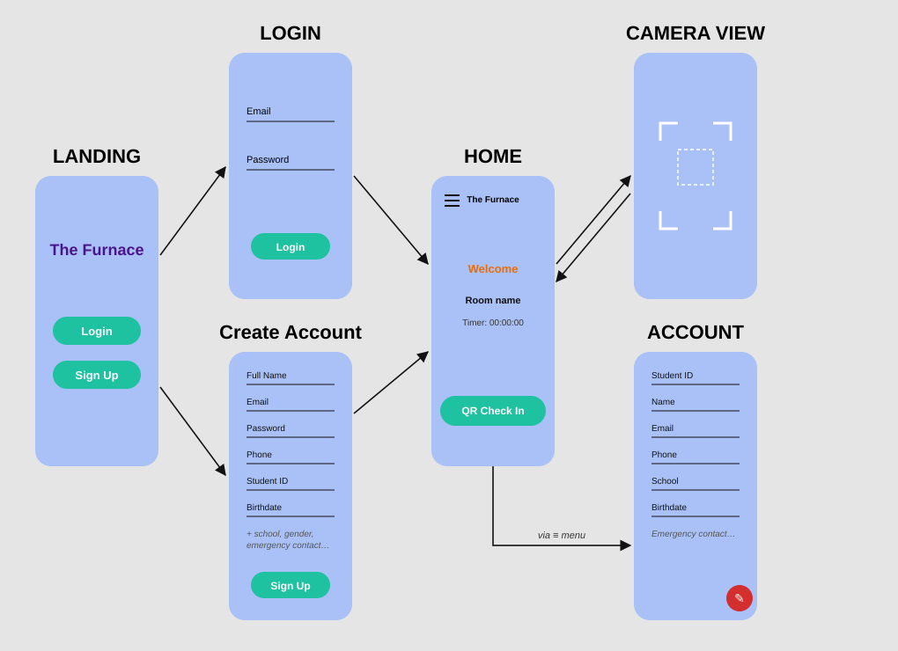

# Furnace App

A mobile app for the Furnace Teen Center that allows for scanning QR codes to log information into a database. 

## Mockup

## Schema (Parse back4app)
### Models

#### User (See [ParseUser](https://pub.dev/documentation/flutter_parse/latest/flutter_parse/ParseUser-class.html) for full details, below are the most relevant properties)

| Property | Type               | Description                           |
| -------- | ------------------ | ------------------------------------- |
| username  | String | The email used as the identfying username for the user |
| fullName     | String             | The user's full real name |

#### Log 

| Property | Type               | Description                           |
| -------- | ------------------ | ------------------------------------- |
| createdAt  | Date | The exact timestamp the log was created. Generated automatically |
| location     | String             | The location the user checked in/out of, provided by the scanned QR code |
| user     | Pointer to Object         | A pointer to the user who created the log|

## Packages
- [Parse Server Sdk Flutter](https://pub.dev/packages/parse_server_sdk_flutter)
- [Camera](https://pub.dev/packages/camera)
- [Flutter Barcode Scanner](https://pub.dev/packages/flutter_barcode_scanner)

## Flutter Resources

A few resources to get you started if this is your first Flutter project:

- [Lab: Write your first Flutter app](https://flutter.dev/docs/get-started/codelab)
- [Cookbook: Useful Flutter samples](https://flutter.dev/docs/cookbook)

For help getting started with Flutter, view the
[online documentation](https://flutter.dev/docs), which offers tutorials,
samples, guidance on mobile development, and a full API reference.

#### Furnace QR scanner App environment setup
Basic step by help of setting environment is in "Furnace_QR_scanner_App_environment_setup.pdf" file open with some pdf opener like "Adobe" or "Chrome"